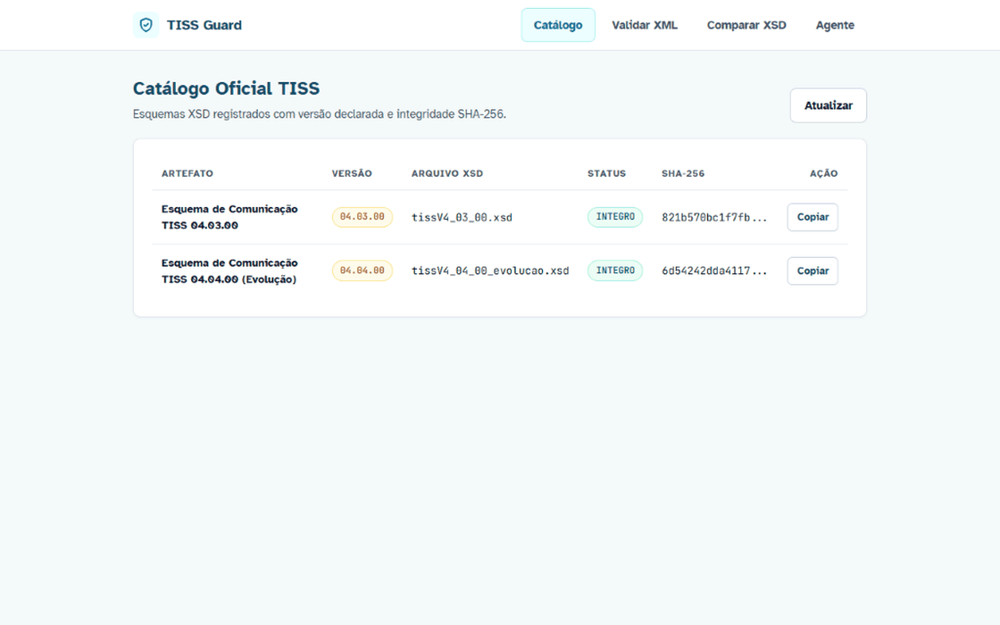

# TISS Guard - Version Monitoring and Technical Validation for the ANS TISS Standard

> **Language:** English | [Português (BR)](README.pt-BR.md)

<p align="center">
  
</p>

Java 21 and Spring Boot application built to catalog official artifacts, validate XML messages against XSD schemas, perform structural diffs across versions of the Brazilian ANS TISS standard (Agência Nacional de Saúde Suplementar), and diagnose breaking contract changes.

It includes an XXE-hardened validation core, structured REST API, deterministic tool-grounded investigator agent, minimalist web demo interface, and an automated GitHub Actions CI pipeline.

---

## Features and Capabilities

* **Official Catalog with SHA-256 Integrity:** Stores TISS artifact metadata with cryptographic integrity verification, change detection, and resilient multi-version coexistence.
* **Safe XML/XSD Validation:** Structural validation against official XSD schemas distinguishing malformed XML from schema-invalid XML, reporting line, column, and error category while blocking XXE and path traversal attacks.
* **Structural Diff and Breaking-Change Analysis:** Reproducible comparison between two XSD versions classifying additive, restrictive, and breaking changes with impact diagnosis and reference hashes.
* **Tool-Grounded Investigator Agent:** Restricted to whitelisted local tools (`consultar_artefatos`, `validar_xml`, `comparar_esquemas`), linking answers to real technical evidence and refusing out-of-scope or unsupported requests.
* **Minimalist Web Demo Interface:** Clean browser UI to inspect the catalog, validate synthetic XML payloads, compare schema versions, and query the investigator agent.
* **Continuous Integration (GitHub Actions):** Automated build and full unit/integration test execution on every push or pull request to `main`.

---

## Project Structure

```text
.
├── .github/
│   └── workflows/
│       └── ci.yml                       # Automated build & test pipeline via GitHub Actions
├── docs/
│   ├── demo-tiss-guard.gif              # Animated demo of the web interface
│   ├── fonte_oficial_tiss.md            # Official ANS reference sources
│   └── limitacoes_demonstracao.md       # Known scope limitations
├── src/
│   ├── main/
│   │   ├── java/br/com/tissguard/
│   │   │   ├── agente/                  # Explicit tools and AgenteInvestigador
│   │   │   ├── api/                     # REST controllers, DTOs, and global error handling
│   │   │   ├── catalogo/                # Local catalog, SHA-256 hashing, and change detection
│   │   │   ├── comparacao/              # Structural XSD diff engine and breaking-change diagnosis
│   │   │   ├── config/                  # Environment properties and default catalog bootstrap
│   │   │   ├── dominio/                 # TISS domain models
│   │   │   ├── fontes/                  # Resilient artifact fetcher
│   │   │   ├── validacao/               # Safe XML parser, XSD validator, and input guards
│   │   │   └── TissGuardApplication.java
│   │   └── resources/
│   │       ├── esquemas_xsd/            # Reference XSD schemas for clean-environment runs
│   │       ├── static/                  # Minimalist web UI (HTML, CSS, JS)
│   │       ├── application.properties   # Environment-variable-driven configuration
│   │       └── application-demo.properties
│   └── test/                            # Unit, edge-case, API, integration, and MVP tests
├── .env.example                         # Example environment variables
├── .gitignore
├── pom.xml                              # Maven build & Spring Boot dependencies
├── README.md                            # English documentation
└── README.pt-BR.md                      # Portuguese documentation
```

---

## How to Run

### 1. Prerequisites

* Java 21 (JDK 21)
* Apache Maven 3.9+

### 2. Environment Variables (Optional)

The application ships with safe defaults and can be configured via environment variables (see `.env.example`):

```env
SERVER_PORT=8080
SPRING_MULTIPART_MAX_FILE_SIZE=5MB
SPRING_MULTIPART_MAX_REQUEST_SIZE=5MB
TISSGUARD_MAX_UPLOAD_BYTES=5242880
TISSGUARD_DIRETORIO_ARTEFATOS=dados/artefatos
TISSGUARD_TIMEOUT_VALIDACAO_SEGUNDOS=10
```

### 3. Start the Application and Web Interface

```bash
mvn spring-boot:run
```

Or using the demo profile:

```bash
mvn spring-boot:run -Dspring-boot.run.profiles=demo
```

Open in your browser: `http://localhost:8080`

### 4. Run the Automated Test Suite

```bash
mvn clean test
```

### 5. Main API Endpoints

* `GET /api/v1/artefatos` — Lists cataloged artifacts (optional `componente` filter).
* `GET /api/v1/artefatos/versoes` — Lists available schema versions in the catalog.
* `POST /api/v1/validacao/xml` — Validates a synthetic XML payload against the selected XSD version.
* `POST /api/v1/comparacao/esquemas` — Compares two XSD schema versions structurally.
* `POST /api/v1/agente/investigar` — Runs a deterministic tool-backed technical investigation.

---

## GitHub Actions Automation

The `.github/workflows/ci.yml` workflow automatically runs `mvn -B clean test` in a clean Linux environment with Java 21 (Temurin) on every push or pull request to `main`.

---

## Known Limitations

* XML/XSD validation verifies structural compliance only and does not replace billing rules, TUSS tables, or medical claim auditing.
* Use only synthetic XML examples in the demo interface; never submit real patient data.
* Full technical limitations are documented in `docs/limitacoes_demonstracao.md`.

---

## Author

Ronaldo Dutra Filho
