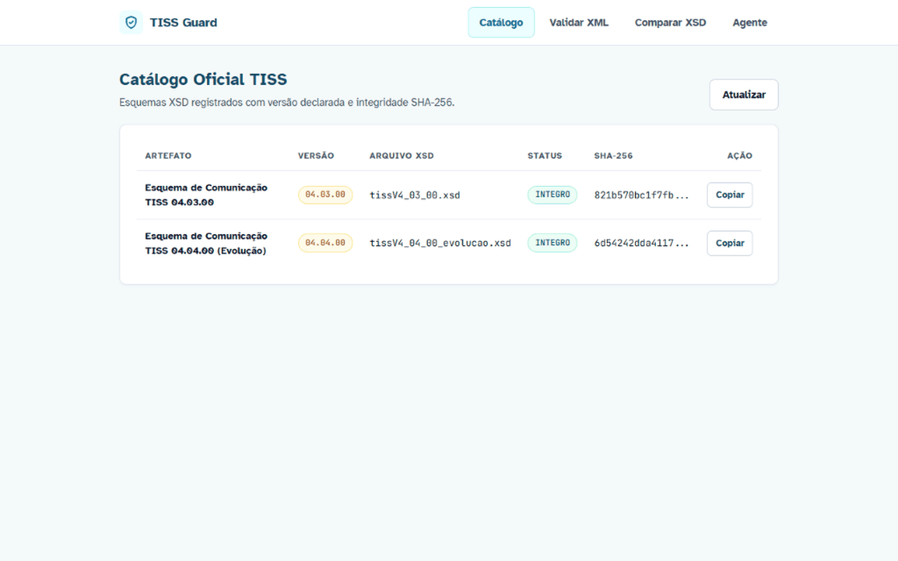

# TISS Guard - Monitoramento de Versões e Validação Técnica do Padrão TISS

> **Idioma:** [English](README.md) | Português (BR)

<p align="center">
  
</p>

Aplicação desenvolvida em Java 21 com Spring Boot para catalogar artefatos oficiais, validar mensagens XML contra esquemas XSD, comparar estruturalmente versões do padrão TISS da ANS (Agência Nacional de Saúde Suplementar) e diagnosticar quebras de contrato.

Conta com núcleo de validação seguro contra XXE, API REST estruturada, agente investigador determinístico baseado em ferramentas técnicas, interface web minimalista de demonstração e pipeline de testes automatizados com GitHub Actions.

---

## Recursos e Funcionalidades

* **Catálogo Oficial com Integridade SHA-256:** Registro de metadados de artefatos TISS com verificação de integridade criptográfica, detecção de alterações e coexistência resiliente de múltiplas versões.
* **Validação XML/XSD Segura:** Validação estrutural contra esquemas XSD oficiais diferenciando XML malformado de XML inválido, com indicação de linha, coluna, categoria de erro e bloqueio de entidades externas (XXE) e travessia de diretório.
* **Comparação Estrutural e Quebra de Contrato:** Análise reproduzível entre duas versões de esquemas XSD, classificando alterações aditivas, restritivas e quebras de contrato com diagnóstico de impacto e hashes de referência.
* **Agente Investigador com Ferramentas:** Agente restrito a ferramentas técnicas homologadas (`consultar_artefatos`, `validar_xml`, `comparar_esquemas`), vinculando respostas a evidências reais e recusando solicitações fora de escopo ou sem dados suficientes.
* **Interface Web de Demonstração:** Painel limpo e acessível para consultar o catálogo, validar XMLs sintéticos, comparar versões de esquemas e acionar o agente investigador diretamente no navegador.
* **Integração Contínua (GitHub Actions):** Execução automatizada de build e suíte de testes unitários e integrados a cada push ou pull request na branch `main`.

---

## Estrutura do projeto

```text
.
├── .github/
│   └── workflows/
│       └── ci.yml                       # Pipeline de build e testes via GitHub Actions
├── docs/
│   ├── demo-tiss-guard.gif              # Demonstração animada da interface web
│   ├── fonte_oficial_tiss.md            # Registro das fontes oficiais da ANS
│   └── limitacoes_demonstracao.md       # Limitações conhecidas do escopo atual
├── src/
│   ├── main/
│   │   ├── java/br/com/tissguard/
│   │   │   ├── agente/                  # Ferramentas explícitas e AgenteInvestigador
│   │   │   ├── api/                     # Controladores REST, DTOs e tratamento global de erros
│   │   │   ├── catalogo/                # Catálogo local, hash SHA-256 e detecção de alterações
│   │   │   ├── comparacao/              # Comparador estrutural de XSD e diagnóstico de quebra
│   │   │   ├── config/                  # Propriedades por ambiente e inicialização do catálogo
│   │   │   ├── dominio/                 # Modelos de domínio TISS
│   │   │   ├── fontes/                  # Obtenção resiliente de artefatos oficiais
│   │   │   ├── validacao/               # Parser XML seguro, validador XSD e proteções de entrada
│   │   │   └── TissGuardApplication.java
│   │   └── resources/
│   │       ├── esquemas_xsd/            # Esquemas XSD de referência para execução limpa
│   │       ├── static/                  # Interface web minimalista (HTML, CSS e JS)
│   │       ├── application.properties   # Configuração parametrizada por variáveis de ambiente
│   │       └── application-demo.properties
│   └── test/                            # Testes unitários, de borda, API, integração e aceite MVP
├── .env.example                         # Exemplo de variáveis de ambiente
├── .gitignore
├── pom.xml                              # Configuração Maven e dependências Spring Boot
├── README.md                            # Documentação principal em inglês
└── README.pt-BR.md                      # Documentação em português
```

---

## Como executar

### 1. Pré-requisitos

* Java 21 (JDK 21)
* Apache Maven 3.9+

### 2. Variáveis de Ambiente (Opcional)

A aplicação possui valores padrão seguros, mas pode ser configurada via variáveis de ambiente (conforme `.env.example`):

```env
SERVER_PORT=8080
SPRING_MULTIPART_MAX_FILE_SIZE=5MB
SPRING_MULTIPART_MAX_REQUEST_SIZE=5MB
TISSGUARD_MAX_UPLOAD_BYTES=5242880
TISSGUARD_DIRETORIO_ARTEFATOS=dados/artefatos
TISSGUARD_TIMEOUT_VALIDACAO_SEGUNDOS=10
```

### 3. Execução da Aplicação e Interface Web

```bash
mvn spring-boot:run
```

Ou com o perfil de demonstração:

```bash
mvn spring-boot:run -Dspring-boot.run.profiles=demo
```

Acesse no navegador: `http://localhost:8080`

### 4. Execução dos Testes Automatizados

```bash
mvn clean test
```

### 5. Principais Endpoints da API

* `GET /api/v1/artefatos` — Lista os artefatos catalogados (com filtro opcional por `componente`).
* `GET /api/v1/artefatos/versoes` — Lista as versões disponíveis no catálogo.
* `POST /api/v1/validacao/xml` — Valida um conteúdo XML sintético contra a versão de esquema informada.
* `POST /api/v1/comparacao/esquemas` — Compara estruturalmente duas versões de esquemas XSD.
* `POST /api/v1/agente/investigar` — Executa investigação técnica fundamentada nas ferramentas do agente.

---

## Automação com GitHub Actions

O workflow `.github/workflows/ci.yml` executa automaticamente `mvn -B clean test` em ambiente Linux limpo com Java 21 (Temurin) a cada push ou pull request para a branch `main`.

---

## Limitações Conhecidas

* A validação XML/XSD verifica conformidade estrutural e não substitui regras de negócio, tabelas TUSS ou auditoria de faturamento/glosa.
* Utilize apenas exemplos sintéticos na interface de demonstração; não envie dados reais de pacientes.
* Detalhes completos das limitações técnicas estão documentados em `docs/limitacoes_demonstracao.md`.

---

## Autor

Ronaldo Dutra Filho
